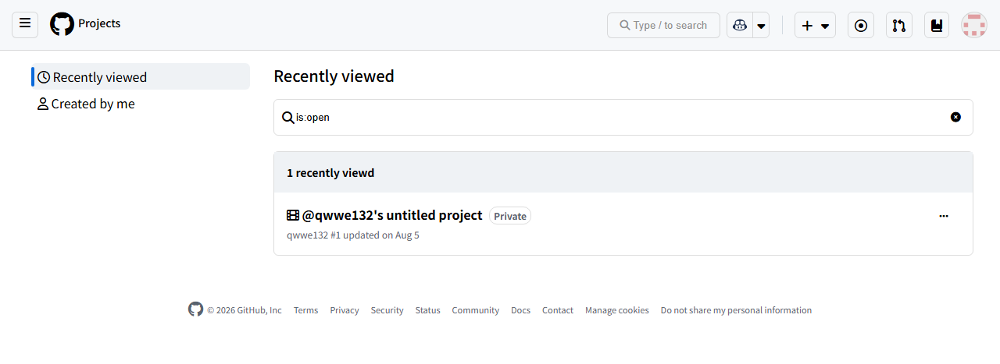
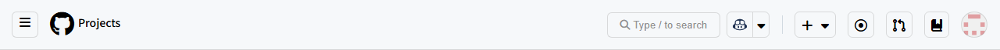
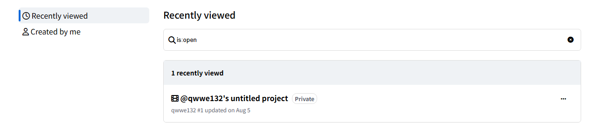

# GitHub Projects 화면 클론

GitHub Projects의 Recently viewed 화면을 HTML과 CSS로 구현한 클론 코딩 과제입니다. 상단 탐색 영역, 검색 입력과 프로젝트 목록, 하단 링크 영역을 구성했습니다.

## 실행 방법

저장소를 내려받아 `project.html`을 브라우저에서 엽니다. 아이콘은 Font Awesome CDN에서 불러옵니다.

## 화면 캡처

### 전체 화면

### 헤더

### 메인

### 푸터

